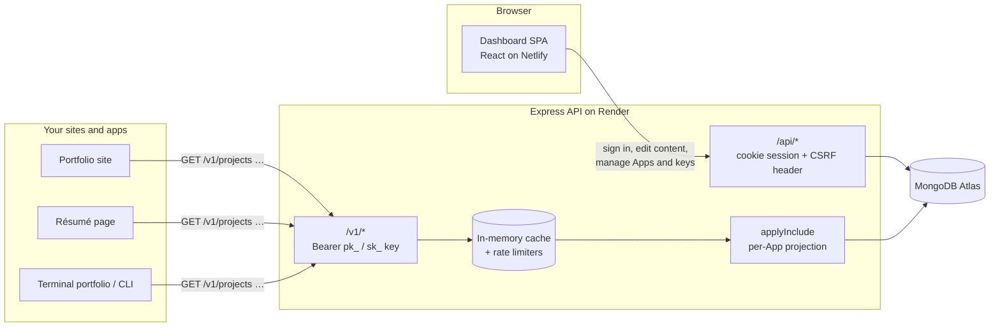

# Portfolio Control

**Your portfolio content, as an API.** Write your profile, projects, skills, experience, education, certifications and social links once. Every site you build reads them from one read-only JSON API, and each site sees only what you grant it.

| | |
| :--- | :--- |
| **Live dashboard** | https://portfolio-control-sst.netlify.app |
| **Live API** | https://portfolio-api-2oie.onrender.com (health: [`/livez`](https://portfolio-api-2oie.onrender.com/livez)) |
| **Demo video** | https://drive.google.com/file/d/1yJ2gbaponcffXqlOh1LISknND9fQiCv0/view?usp=sharing |
| **Source** | https://github.com/Sarthaks-24/AdminPanelCMS |

> The API runs on Render's free plan. After 15 idle minutes it sleeps, and the first request can take up to a minute to wake it. If the dashboard says it can't reach the server, wait a moment and retry.

---

## Problem statement

Developers, designers and students keep the same professional content in many places: a portfolio site, a résumé page, a terminal-style portfolio, a blog sidebar, a GitHub README, a mobile app. Each copy is hardcoded or kept in its own JSON file. When something changes (a new job, a new project, a new certificate), every copy has to be edited and redeployed by hand. They drift apart, and they go stale.

General headless CMSes (Contentful, Sanity, Strapi) can solve this, but you have to design the schema yourself. They also usually give a site either all of your content or none of it. You can't easily say "this résumé page may see three featured projects and no email address."

## Target users

- Developers and students who run more than one personal site or app.
- Job-seekers who keep a portfolio and a résumé page and want both to stay in sync.
- Anyone building a portfolio who wants a ready-made content backend instead of a hand-written JSON file.

## Solution

Portfolio Control is a hosted, multi-tenant content service with a fixed schema built for portfolio and résumé data:

1. You **sign up** and enter your content once in a dashboard.
2. You create one **App** per site you build. An App is a *scoped, read-only view* of your content: which sections, which items, and which fields that site may read.
3. Each App gets its own **API keys**. Use a secret key (`sk_live_…`) for servers and build steps. Use a publishable key (`pk_live_…`) in browsers, limited to the origins you allow.
4. Each site calls `GET /v1/...` and gets back only what its App allows, as JSON. Edit content once and every connected site sees the change.

The core idea is the per-App field allowlist. Apps never copy your data. They are projections of one content pool, computed on every request.

## Key features (the main workflows)

1. **Account lifecycle.** Email-first signup with verification (you set the password from the emailed link), login, password reset, change password, sign out of all devices, JSON export of all your data, and self-service account deletion with password confirmation.
2. **Content management.** Eight sections: profile, résumé, socials, skills, projects, experience, education and certifications. Each item can be draft or published, featured, and reordered. Drafts are never served by the API. Input is validated, and each section has a quota.
3. **Apps as scoped views.** For each section, choose `all`, `featured` or a hand-picked list of items, then the exact fields to expose. A live preview shows the JSON that the App will return. A disabled section returns `403 section_disabled`, so a developer can tell "turned off" apart from "empty".
4. **API keys and connecting a site.** Create, rotate (at most two live keys per App) and revoke keys. Publishable keys only work from allowlisted origins. The Connect panel shows ready-to-paste snippets and a **Check this App** button that makes a real call and explains any error.
5. **Public read-only API (`/v1`).** Endpoints for every section, plus `/v1/fs`, which returns the same content as a virtual file tree for terminal-style portfolios. Responses carry ETags and a 60-second cache, with per-key, per-owner and global rate limits.
6. **Operator tools.** A superadmin panel for the signup mode (closed / invite / open), invite codes, user overview and suspension.

## Tech stack

| Layer | Technology | Why |
| :--- | :--- | :--- |
| API | Node.js 22, Express 5 | One long-running process serves the dashboard API and the public API |
| Database | MongoDB Atlas, Mongoose 9 | Document model fits per-section content with varying fields |
| Auth | JWT in an httpOnly cookie, bcrypt, hashed email tokens | No token in `localStorage`; sessions can be revoked |
| Security | Helmet, express-rate-limit, CSP, input sanitising, owner-scoping guard | Many tenants share one database |
| Email | Resend (falls back to printing emails to the log in development) | Verification and password-reset mail |
| Logging | pino, pino-http, request IDs | Structured logs for debugging the hosted service |
| Dashboard | React 19, Vite 8, React Router 7, Tailwind CSS 3, Axios | Lazy-loaded routes, built-in themes plus a custom theme builder |
| Tests | Vitest, Supertest, mongodb-memory-server; oxlint | 320+ server tests run against an in-memory database |
| Hosting | Render (API, Docker), Netlify (dashboard), GitHub Actions (CI, heartbeat) | Free tiers; CI must pass before deploy |

## Architecture



**Two deployables.** The static dashboard bundle, and one Node process that serves both `/api` (for the dashboard) and `/v1` (for consumers).

**Data model.** A `User` (tenant) owns up to 10 `App`s, and each App has at most 2 active `ApiToken`s. All content documents (`Profile`, `Resume`, `Social`, `Skill`, `Project`, `Experience`, `Education`, `Certification`) carry an `owner` field and a `visibility` of `draft` or `published`. Content belongs to the user, not the App, so Apps never duplicate data. Full detail: [docs/DATA_MODEL.md](docs/DATA_MODEL.md).

**The `/v1` request pipeline.**

```
CORS (origin allowlist for pk_) → pre-auth IP limit → sanitise → key lookup (sha256)
→ per-key limit → per-owner limit → global limit → response cache (ETag)
→ load owner's published content → applyInclude (sections, items, fields) → JSON
```

**Engineering decisions worth noting.**

- **Tenant isolation is enforced twice.** A Mongoose plugin (`server/plugins/ownerGuard.js`) rejects any content query that has no concrete `owner`. A static check (`npm run lint:security`) fails CI if a query in the code isn't owner-scoped.
- **Keys are stored as hashes.** Secret keys are shown once. An in-memory set of active key hashes lets invalid keys be rejected before touching the database.
- **Cache invalidation by owner version.** Every content write bumps the owner's version, so cached `/v1` responses for that owner are invalidated at once. Responses also carry ETags, so clients get `304 Not Modified`.
- **Abuse limits.** Concurrent bcrypt checks are capped, so a login flood gets `503 busy` instead of freezing the server. There are also a daily email budget, signup limits per email domain, an invite-code failure guard, and a database-storage guard that blocks writes before the free tier's 512 MB fills up.
- **Single instance by design.** Rate limits and caches live in process memory, so the service runs exactly one instance (`numInstances: 1` in `render.yaml`). That is the right trade-off at this scale. Moving them to Redis is the path to horizontal scaling.
- **A single `MODE=dev|prod` switch.** It picks `DEV_*` or `PROD_*` variables. The production boot refuses unsafe settings, such as a dev database, a weak secret or a missing proxy count.

More: [docs/ARCHITECTURE.md](docs/ARCHITECTURE.md).

## Local setup

You need **Node.js 22+** and a **MongoDB** database (local `mongod` or a free Atlas cluster). You don't need a mail provider: without a Resend key, every email and its link is printed in the API's terminal, so you can walk through signup locally.

```bash
git clone https://github.com/Sarthaks-24/AdminPanelCMS.git
cd AdminPanelCMS

# 1. API
cd server
npm install
cp .env.example .env        # set MODE=dev and fill in the DEV_* block (at least DEV_MONGODB_URI, DEV_JWT_SECRET)
npm run setup               # creates indexes and the first account (ADMIN_EMAIL / DEV_ADMIN_PASSWORD)
npm run seed                # optional: sample content for that account
npm run dev                 # http://localhost:5000

# 2. Dashboard (second terminal)
cd client
npm install
cp .env.example .env
npm run dev                 # http://localhost:5173
```

Open http://localhost:5173, sign in with the account from `npm run setup`, create an App, generate a key, and try:

```bash
curl -H "Authorization: Bearer <your key>" http://localhost:5000/v1/projects
```

The full walkthrough is in [docs/SETUP_GUIDE.md](docs/SETUP_GUIDE.md).

### Tests and checks

```bash
cd server && npm test                 # 320+ tests against an in-memory MongoDB
cd server && npm run lint:security    # static tenant-isolation check
cd client && npm run lint && npm run build
cd client && npm run smoke -- https://portfolio-control-sst.netlify.app https://portfolio-api-2oie.onrender.com
```

CI (`.github/workflows/ci.yml`) runs the server tests, the security lint, and the client lint and build on every push.

## Environment variables

Templates with every variable are in [`server/.env.example`](server/.env.example) and [`client/.env.example`](client/.env.example). Real values are never committed: `.env` files are git-ignored, and production values live only in the Render and Netlify dashboards.

**Server** (with `MODE=dev`, use the `DEV_` prefix; with `MODE=prod`, use `PROD_` or plain names):

| Variable | Required | Purpose |
| :--- | :--- | :--- |
| `MODE` | yes | `dev` or `prod`; selects the `DEV_*` / `PROD_*` values |
| `MONGODB_URI` | yes | MongoDB connection string (production must name its database) |
| `JWT_SECRET` | yes | 32+ random characters; signs session cookies |
| `INVITE_CODE_PEPPER` | prod | 32+ random characters; HMAC key for invite codes |
| `CLIENT_ORIGIN` | yes | Exact origin of the dashboard, for CORS |
| `PUBLIC_API_URL` | prod | Public base URL of the API, shown in the dashboard's snippets |
| `TRUST_PROXY_HOPS` | prod | Reverse proxies in front of Node (`1` on Render) |
| `SESSION_COOKIE_SAMESITE` | no | `lax` (default) or `none` when the dashboard and API are on different sites |
| `SIGNUP_MODE` | no | `closed`, `invite` or `open` (the superadmin panel can override it) |
| `LEGAL_POLICIES_APPROVED` | no | Must be `true` before production signup opens |
| `RESEND_MAIL_KEY`, `RESEND_FROM_EMAIL` | prod | Transactional email |
| `PRODUCT_NAME`, `OPERATOR_NAME`, `SUPPORT_EMAIL` | prod | Shown in email headers and footers |
| `ADMIN_EMAIL`, `ADMIN_PASSWORD` | scripts | Used only by `npm run setup` / `admin` / `seed` |

**Dashboard:**

| Variable | Required | Purpose |
| :--- | :--- | :--- |
| `VITE_MODE` | no | `dev` or `prod` (build defaults to `prod`) |
| `VITE_DEV_API_URL` | dev | API origin for local development (default `http://localhost:5000`) |
| `VITE_PROD_API_URL` | prod | API origin for the production build (https) |
| `VITE_SITE_DOMAIN`, `VITE_SITE_NAME`, `VITE_SITE_OPERATOR`, `VITE_SITE_SUPPORT_EMAIL` | prod | Site identity shown on the public and legal pages |

The full reference, including every tuning variable (rate limits, mail budget, storage guard, backups), is in [docs/ENVIRONMENT.md](docs/ENVIRONMENT.md).

## Deployment

| Part | Host | Config | URL |
| :--- | :--- | :--- | :--- |
| API | Render (free plan, Docker, 1 instance) | [`render.yaml`](render.yaml), [`server/Dockerfile`](server/Dockerfile) | https://portfolio-api-2oie.onrender.com |
| Dashboard | Netlify | [`netlify.toml`](netlify.toml) | https://portfolio-control-sst.netlify.app |
| Database | MongoDB Atlas (M0) | connection string in Render env | — |
| CI | GitHub Actions | [`.github/workflows/ci.yml`](.github/workflows/ci.yml) | — |
| Keep-alive | GitHub Actions, every 10 min | [`.github/workflows/render-heartbeat.yml`](.github/workflows/render-heartbeat.yml) | — |

Both hosts auto-deploy on push. Health endpoints: `/livez` (process is up) and `/readyz` (database is reachable).

The dashboard (`*.netlify.app`) and the API (`*.onrender.com`) are on different sites, so the session cookie is `SameSite=None; Secure; Partitioned`. The `Partitioned` attribute keeps sign-in working in Chrome and Edge even when third-party cookies are blocked (for example in Incognito). Safari doesn't keep this cookie on this free-hostname setup, so use Chrome, Edge or Firefox. Putting both hosts behind one owned domain removes this limit.

Step-by-step deployment guides: [DEPLOYMENT.md](DEPLOYMENT.md) (Render + Netlify, Railway, or a VPS with Docker and Caddy) and [docs/DEPLOYMENT.md](docs/DEPLOYMENT.md). Operations (backups, restore drill, monitoring): [docs/OPERATIONS.md](docs/OPERATIONS.md).

## Using the API

```bash
curl -H "Authorization: Bearer $CONTENT_API_KEY" https://portfolio-api-2oie.onrender.com/v1/projects
```

| Document | Contents |
| :--- | :--- |
| [docs/QUICKSTART.md](docs/QUICKSTART.md) | Sign up → content → an App → a key → your first fetch |
| [docs/API_REFERENCE.md](docs/API_REFERENCE.md) | Every `/v1` endpoint, the `{ data }` envelope, error codes and headers |
| [docs/LIMITS_AND_ERRORS.md](docs/LIMITS_AND_ERRORS.md) | Rate limits, quotas and the error decoder |
| [docs/CONTENT_FIELDS.md](docs/CONTENT_FIELDS.md) | What each section can serve: default, opt-in and never-served fields |

These docs are also rendered on the live site at `/docs`.

## Project structure

```
server/            Express API
  routes/          one router per resource, plus v1.js (public API)
  controllers/     request handlers
  middleware/      sessions, keys, rate limits, CORS, sanitising, errors
  models/          Mongoose schemas
  plugins/         ownerGuard (tenant isolation)
  lib/             applyInclude, cache, mailer, logger, env validation, …
  scripts/         setup, seed, admin, backups, stats
  tests/           Vitest + Supertest + in-memory MongoDB
client/            React dashboard and public site
  src/pages/       public (landing, docs), auth, admin (dashboard screens)
  src/components/  shared UI
  scripts/         build checks and the deployment smoke test
docs/              user docs and operator docs
.github/workflows/ CI, heartbeat, backups
```

## Security

- No secrets in the repository: `.env` files are git-ignored, and only `.env.example` templates are tracked.
- Passwords are bcrypt hashes. API secret keys, email tokens and invite codes are stored only as hashes.
- Sessions are httpOnly, Secure cookies. Dashboard writes require a custom header that cross-site forms can't send.
- Every content query is scoped to its owner, and a guard rejects any query that isn't.
- Helmet headers and a Content Security Policy on the dashboard. User input is validated, and Mongo operators are stripped from it.

To report a vulnerability, see [SECURITY.md](SECURITY.md).

## Known limitations

- Free hosting: the API sleeps after inactivity (cold start up to about a minute), and the database is capped at 512 MB.
- One API instance only. Limits and caches are in memory.
- Media is linked by https URL (for example a Google Drive résumé). There are no file uploads yet.
- The API is read-only. Content is edited only through the dashboard.

## License

[MIT](LICENSE).
